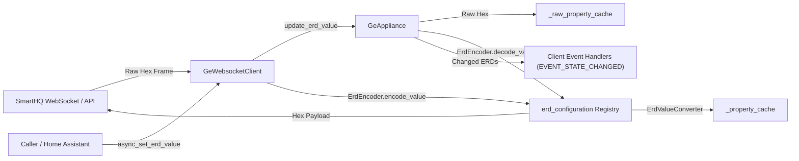

# Architecture Patterns

This document describes the core architectural boundaries and data flows of `gehomesdk`.

---

## 1. Package Structure & Boundaries

```text
gehomesdk/
├── __init__.py              # Public SDK exports and __version__
├── ge_appliance.py          # GeAppliance state model & WeakValueDictionary cache
├── entry_points.py          # CLI entry point (gehome-appliance-data)
├── gather_data.py           # CLI data-collection runner
├── clients/                 # Transport, auth, lifecycle, and event dispatch
│   ├── base_client.py       # GeBaseClient abstract base, auth refresh, event hub
│   ├── websocket_client.py  # GeWebsocketClient persistent WSS connection
│   ├── smart_hq_login.py    # Interactive OAuth2 + MFA login flow (GeSmartHqLogin)
│   ├── async_login_flows.py # Low-level OAuth2/WSS token helpers
│   ├── states.py            # GeClientState enum
│   └── const.py             # Event names & retry/timing constants
├── erd/                     # SmartHQ ERD protocol layer
│   ├── erd_codes.py         # ErdCode enum & ErdCodeType alias
│   ├── erd_code_class.py    # Semantic device/control classifications
│   ├── erd_data_type.py     # Primitive wire data types
│   ├── erd_configuration.py # Central ErdCode -> Converter registry
│   ├── erd_encoder.py       # ErdEncoder runtime lookup & encode/decode facade
│   ├── values/              # Pure Python value types (enums, dataclasses, namedtuples)
│   └── converters/          # ErdValueConverter subclasses (hex <-> Python)
└── exception/               # GeException hierarchy
```

### Dependency Rules

* `erd/values/` must remain pure data definitions with no client or network imports.
* `erd/converters/` depends only on `erd/values/` and standard/value helpers—never on `clients/` or `aiohttp`.
* `ge_appliance.py` depends on `erd/` and `exception/`, interacting with `clients/` only via `GeBaseClient` interface methods.
* `clients/` orchestrates `aiohttp`/`websockets` I/O, authentication, and `GeAppliance` updates.

---

## 2. Data Flow: Inbound & Outbound ERD Pipeline



### Key Invariants

1. **Dual Cache Fidelity:** `GeAppliance` stores both the decoded Python object (`_property_cache`) and the raw wire hex string (`_raw_property_cache`). Unrecognized ERD codes fall back to raw bytes without crashing.
2. **Appliance Identity & Priority:** `GeAppliance.__new__` caches instances by uppercase MAC address in a `WeakValueDictionary`. If multiple clients exist, a higher-or-equal `client_priority` updates the appliance's active `client` reference.
3. **Event-Driven Callbacks:** Clients notify consumers via registered async/sync handlers (`EVENT_CONNECTED`, `EVENT_DISCONNECTED`, `EVENT_GOT_APPLIANCE_LIST`, `EVENT_ADD_APPLIANCE`, `EVENT_APPLIANCE_INITIAL_UPDATE`, `EVENT_STATE_CHANGED`, `EVENT_APPLIANCE_AVAILABLE`, `EVENT_APPLIANCE_UNAVAILABLE`).

---

## 3. Authentication & Token Lifecycle

* **Interactive / MFA Login:** `GeSmartHqLogin` handles OAuth2 login, MFA method selection, verification code submission, and returns the token payload containing `refresh_token`.
* **Reconnect & Token Rotation:** `GeBaseClient` accepts an optional `refresh_token` and rotates `self._refresh_token` when refreshing credentials.
* **Error Separation:**
  * Auth rejections (`GeAuthFailedError`, `GeAuthMfaRequiredError`, `GeAuthTermsRequiredError`) surface explicitly or trigger configured fallback.
  * Transient network/timeout errors (`aiohttp.ClientError`, `asyncio.TimeoutError`) must propagate without wiping a valid `refresh_token` or forcing an unnecessary full login that would re-trigger MFA.

---

## 4. Async & Lifecycle Hygiene

* All network I/O uses `aiohttp.ClientSession` and `websockets` asynchronously.
* Consumers pass or share an `aiohttp.ClientSession` where appropriate; never leave unclosed sessions or orphaned background tasks on `disconnect()`.
